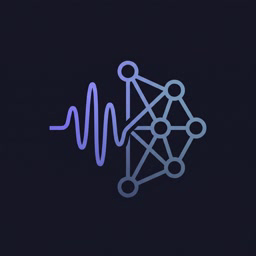
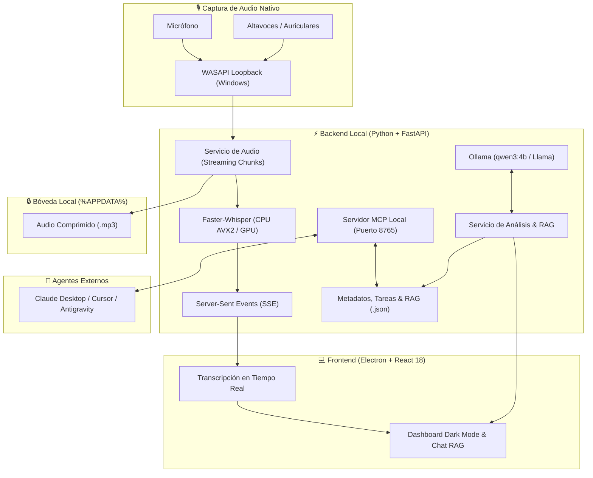

<p align="center">
  
</p>

<h1 align="center">Local Meeting Analyzer</h1>

<p align="center">
  <strong>Grabador y Asistente de Reuniones con IA 100% Local para Windows.</strong><br>
  Sin bots intrusivos en tus llamadas, sin suscripciones mensuales y con privacidad absoluta: tus audios y conversaciones nunca salen de tu equipo.
</p>

<p align="center">
  <a href="docs/REQUISITOS.md"></a>
  <a href="LICENSE"></a>
  <a href="https://github.com/SYSTRAN/faster-whisper"></a>
  <a href="https://ollama.com"></a>
  <a href="docs/MCP-INTEGRACION.md"></a>
  <a href="https://local-meeting-analyzer.vercel.app/"></a>
</p>

<p align="center">
  <a href="https://local-meeting-analyzer.vercel.app/"><strong>🌐 Web Oficial & Descarga Directa</strong></a> •
  <a href="https://github.com/edixon-javier/local-meeting-analyzer/releases"><strong>⬇️ Releases en GitHub</strong></a> •
  <a href="#-arquitectura-del-sistema"><strong>🏛️ Arquitectura</strong></a> •
  <a href="#-servidor-mcp-model-context-protocol"><strong>🤖 Servidor MCP</strong></a> •
  <a href="#-garantía-de-privacidad-y-seguridad"><strong>🛡️ Privacidad</strong></a>
</p>

---

## 💡 ¿Por qué Local-First?

Las herramientas tradicionales de transcripción (Otter, Fireflies, Zoom AI Companion) introducen bots visibles que incomodan a los clientes, exigen costosas suscripciones y almacenan tus reuniones de negocios en servidores de terceros. 

**Local Meeting Analyzer** revoluciona este flujo con una arquitectura **100% privada y local**:

| Característica | Herramientas Cloud (Otter, Fireflies) | Local Meeting Analyzer |
|---|:---:|:---:|
| **Presencia en la llamada** | 🤖 Bot visible obligatorio | 🎙️ **WASAPI Loopback (100% invisible)** |
| **Ubicación del Audio** | ☁️ Servidores cloud de terceros | 🔒 **Tu propio SSD (`%APPDATA%`)** |
| **Modelo de Precios** | 💳 $20 – $40 USD / usuario / mes | 🆓 **Gratuito y de Código Abierto (AGPL-3.0)** |
| **Motor de Inteligencia** | ☁️ APIs en la nube cerradas | 🧠 **Faster-Whisper + Ollama (Qwen / Llama)** |
| **Integración con Agentes** | ❌ Ecosistemas cerrados | 🤖 **Servidor MCP Local (Claude / Cursor)** |
| **Telemetría y Rastreo** | 📊 Recolección activa | 🛡️ **0% telemetría, 0% publicidad** |

---

## ✨ Capacidades Principales

- 🎙️ **Captura Invisible por Bucle Invertido (WASAPI Loopback)**: Graba en tiempo real el audio que sale de tus altavoces/auriculares mezclado con tu micrófono. Funciona de inmediato en Google Meet, Microsoft Teams, Zoom, Slack o Discord sin requerir permisos de administrador ni invitar participantes virtuales.
- ⚡ **Transcripción Ultrarrápida con Faster-Whisper**: Motor optimizado con CTranslate2 para CPU (AVX2) o GPU NVIDIA. Transcribe palabra por palabra en tiempo real con latencia mínima y soporte para múltiples idiomas.
- 🧠 **Minutas y Extracción Estructurada con Ollama**: Genera resúmenes ejecutivos, acuerdos clave, listas de tareas con responsables y análisis de tono mediante modelos locales abiertos (modelo por defecto: `qwen3:4b`, compatible con `phi3`, `llama3`). *(Opción de conectar OpenAI, Claude, Gemini o Groq si introduces tu propia clave API).*
- 👥 **Diarización Contextual por Texto**: Separa las intervenciones de los participantes analizando la estructura del diálogo mediante el modelo de lenguaje (sin requerir biometría de voz), permitiendo renombrar interlocutores en un solo clic ("Hablante A" → "Carlos - Lead Arch").
- 💬 **Bóveda RAG & Chat Global**: Realiza preguntas sobre una reunión específica o busca información semántica cruzada sobre todo tu historial acumulado de reuniones guardadas en JSON local.
- 🤖 **Servidor MCP Nativo (Model Context Protocol)**: Conecta tus grabaciones locales directamente a entornos como **Claude Desktop**, **Cursor** o **Antigravity** sin exponer tus datos a Internet.
- 🎧 **Gestión y Exportación Inmediata**: Escucha o exporta grabaciones a MP3 comprimido, genera minutas en PDF o Markdown y abre el directorio local con un solo clic.
- 🎨 **Interfaz Dark Mode de Nivel Profesional**: Construida con Electron, React 18 y Tailwind CSS, ofreciendo animaciones suaves, atajos de teclado globales y soporte offline continuo.

---

## 🏛️ Arquitectura del Sistema



---

## 🚀 Inicio Rápido (Usuarios)

### 1. Descarga la Aplicación
- **Opción A (Recomendada)**: Descarga directa en 1 clic desde nuestra [Web Oficial (local-meeting-analyzer.vercel.app)](https://local-meeting-analyzer.vercel.app/).
- **Opción B**: Descarga el instalador `.exe` desde la sección de [GitHub Releases](https://github.com/edixon-javier/local-meeting-analyzer/releases).

### 2. Primeros Pasos
1. **Instala Ollama** (gratuito) desde [ollama.com](https://ollama.com) y descarga el modelo por defecto en terminal:
   ```bash
   ollama run qwen3:4b
   ```
   *(Alternativa para equipos con menos memoria RAM: `ollama run qwen3:1.5b` o `llama3.2:1b`).*
2. **Ejecuta Local Meeting Analyzer**: Acepta el aviso ético de consentimiento la primera vez.
3. **Inicia tu grabación**: Haz clic en el botón principal o utiliza el atajo global **`Ctrl + Shift + R`**.

---

## 💻 Requisitos de Hardware

Para más detalles técnicos, consulta el documento completo de [Requisitos del Sistema](docs/REQUISITOS.md).

| Componente | Requisito Mínimo | Configuración Recomendada |
|---|---|---|
| **Sistema Operativo** | Windows 10 (Build 1809+) o Windows 11 (64-bit) | Windows 11 x64 |
| **Procesador (CPU)** | x64 Quad-Core con soporte AVX2 | 6 núcleos o superior (Intel 11th Gen+ / AMD Ryzen 5000+) |
| **Memoria RAM** | 8 GB | 16 GB o superior |
| **Almacenamiento** | 10 GB de espacio libre | SSD NVMe con 20 GB libres |
| **Aceleración GPU** | *Opcional* (Faster-Whisper y Ollama corren fluidamente en CPU) | NVIDIA RTX (CUDA) o AMD compatible |
| **Audio** | Micrófono y altavoces/auriculares configurados en Windows | Auriculares para evitar feedback acústico |

---

## 🛠️ Instalación y Desarrollo (Código Fuente)

Si deseas clonar el proyecto, auditar el código o construir nuevas funciones:

### Prerrequisitos
- **Node.js**: v18 o superior ([nodejs.org](https://nodejs.org/)).
- **Python**: 3.10 a 3.14 ([python.org](https://python.org/)).
- **FFmpeg**: Instalado y añadido al `PATH` del sistema.
- **Ollama**: En ejecución en `http://localhost:11434`.

### 1. Clonar el Repositorio
```bash
git clone https://github.com/edixon-javier/local-meeting-analyzer.git
cd local-meeting-analyzer
```

### 2. Arranque Rápido con 1 Clic (Windows)
Ejecuta el script automatizado:
```cmd
start.bat
```
*Este script crea los entornos virtuales de Python, instala las dependencias de `backend/` y `frontend/` y levanta simultáneamente ambos procesos.*

### 3. Arranque Manual en Terminales Separadas

**Terminal 1 — Backend (FastAPI):**
```bash
cd backend
python -m venv venv
venv\Scripts\activate
pip install -r requirements.txt
python main.py
```

**Terminal 2 — Frontend (Electron + React):**
```bash
cd frontend
npm install
npm run dev
```

### 4. Pruebas Automatizadas
```bash
# Tests de Backend (Pytest)
cd backend && pytest

# Tests de Frontend (Vitest)
cd frontend && npm test
```

---

## 🤖 Servidor MCP (Model Context Protocol)

Local Meeting Analyzer integra un servidor MCP nativo para que cualquier agente de IA pueda interactuar de manera segura con tu historial de reuniones.

### Configuración en Claude Desktop o Cursor
Añade la siguiente sección a tu archivo de configuración (ej. `claude_desktop_config.json`):

```json
{
  "mcpServers": {
    "local-meeting-analyzer": {
      "url": "http://127.0.0.1:8765/mcp"
    }
  }
}
```

### Herramientas MCP Expuestas:
- `search_meetings(query)`: Búsqueda semántica cruzada en el historial.
- `get_meeting_summary(meeting_id)`: Obtiene minutas, acuerdos y puntos de acción.
- `get_meeting_transcript(meeting_id)`: Devuelve la transcripción completa con marcas de tiempo.
- `list_pending_tasks()`: Extrae las tareas pendientes generadas en tus reuniones.

Consulta la guía técnica en [docs/MCP-INTEGRACION.md](docs/MCP-INTEGRACION.md).

---

## 🛡️ Garantía de Privacidad y Seguridad

> [!IMPORTANT]
> Tus reuniones contienen propiedad intelectual, secretos comerciales y datos personales. Por diseño, Local Meeting Analyzer adopta un modelo estricto de confianza cero en la nube:

1. **Almacenamiento Local**: Todo se guarda exclusivamente en `%APPDATA%\Local Meeting Analyzer\`.
2. **Cero Telemetría**: La aplicación no incluye trackers de analíticas, publicidad ni identificadores personales.
3. **Nube Estrictamente Opcional**: Ningún audio ni dato sale a Internet por defecto. Solo se conectará a servicios remotos (OpenAI, Claude, Gemini o Groq) si decides activarlos voluntariamente con tu propia clave API en los Ajustes.
4. **Recomendación de Cifrado**: Los archivos locales no se cifran por defecto; se recomienda habilitar **BitLocker** en la unidad del sistema.
5. **Responsabilidad Legal**: Eres responsable de cumplir con las normativas locales sobre grabación y consentimiento de terceros. Consulta nuestro [Aviso de Consentimiento](legal/CONSENT_NOTICE.md) y la [Política de Privacidad](legal/PRIVACY.md).

---

## 🤝 Contribuciones

¡Las contribuciones de la comunidad son muy bienvenidas!
1. Haz un Fork del repositorio.
2. Crea una rama para tu característica (`git checkout -b feature/nueva-capacidad`).
3. Sigue la convención de [Conventional Commits](https://www.conventionalcommits.org/).
4. Asegúrate de que las pruebas pasen (`pytest` y `npm test`).
5. Abre un Pull Request detallando tu implementación.

---

## ⚖️ Licencia y Reconocimientos

Distribuido bajo la **GNU Affero General Public License v3.0 o posterior (AGPL-3.0-or-later)**. Consulta el archivo [`LICENSE`](LICENSE) para más detalles.

- Modelos de Voz impulsados por [Faster-Whisper](https://github.com/SYSTRAN/faster-whisper) (MIT / Apache-2.0).
- Modelos de Lenguaje soportados a través de [Ollama](https://ollama.com/) (MIT).
- Aviso de componentes de terceros: [`THIRD_PARTY_NOTICES.md`](THIRD_PARTY_NOTICES.md).

<p align="center">
  Hecho con ❤️ para la comunidad de IA local y privacidad-primero.
</p>
